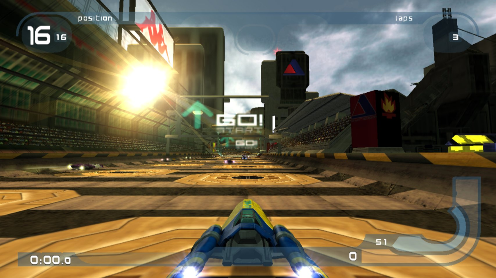
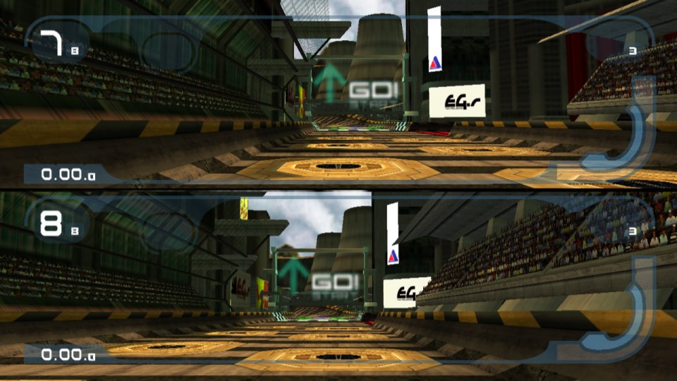
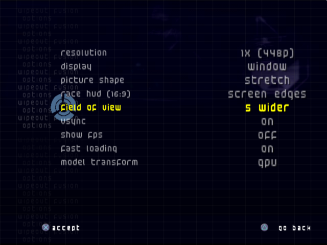
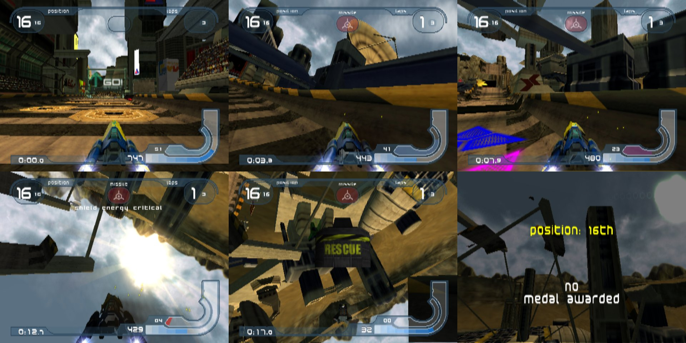
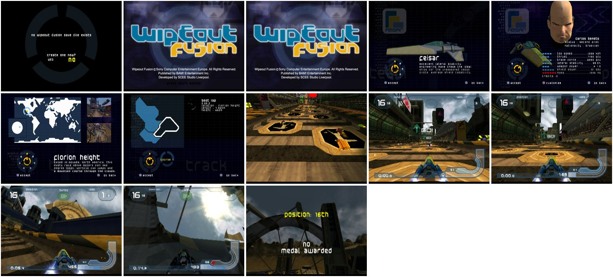
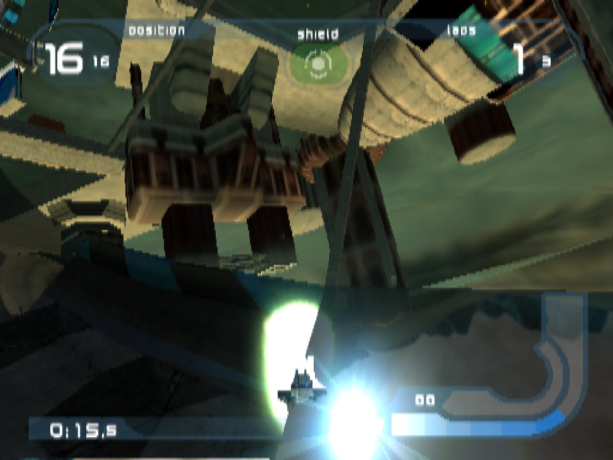

<h1 align="center">WipEout Synthesis</h1>

<p align="center">
  <b>A native PC port of WipEout Fusion (PS2) for Linux, Windows and macOS, built from your own disc.</b>
</p>

<p align="center">
  <a href="https://github.com/JackyPendrag0n/wipeout-synthesis/actions/workflows/check.yml"></a>
  
  
</p>

<p align="center"></p>

WipEout Synthesis turns **WipEout Fusion** (PlayStation 2, NTSC-U, SLUS-20462) into a native PC game.
The game's MIPS code is statically recompiled to C++ with
[PS2Recomp](https://github.com/ran-j/PS2Recomp), and the PS2 hardware is replaced with native code:
an OpenGL renderer, recompiled VU1 microcode, the sound and file drivers translated to C++,
memory-card saves in a folder, FMV playback and keyboard/gamepad input. It is not an emulator.

> [!IMPORTANT]
> **Bring your own disc.** This repository contains no game code, data or assets, and none will be
> accepted. You need your own copy of WipEout Fusion, dumped to an `.iso` from your own disc. The
> build reads it on your machine and generates everything game-specific there. Never upload ISOs,
> extracted files, generated code or built binaries to this repository or its issues.

Not affiliated with or endorsed by Sony Interactive Entertainment or Studio Liverpool.
"WipEout" is a trademark of Sony Interactive Entertainment.

## Features

- **High internal resolutions**, from the PS2's 448p up to 8x, switchable live with F9.
- **True 16:9**: a wider camera rather than a stretched picture, a race HUD that moves out to the
  screen edges, and the weapon lock-on reticle placed correctly.
- **Field of view slider**, window or full screen, vsync, and an FPS counter.
- **An in-game Graphics page**: the game's own Options menu gets a "graphics" page in its own style,
  and every change applies live and is saved to `graphics.ini`.
- **GPU model transform**: ship and track geometry is transformed on the GPU, with batched model
  draws on OpenGL 4.3+, so high resolutions stay fast.
- **Native everything**: all of the game's VU1 microcode programs run as recompiled C++, and the
  IOP modules (sound, streaming, files, pads, memory card, CD) are translated to C++ too.
- **Two players split screen**, with the second gamepad (or the keyboard).
- **Fast loading**, memory-card saves to a folder, and the game's FMVs played back with FFmpeg.
- **Texture dumping and texture packs**: dump every texture, then replace any of them at any size.
- **PC overlay (F10, or L3 + R3 on a gamepad)** with fun options: weapons in 2-player races, all
  super weapons, a custom weapon set, weapon damage and uses, and unlock everything.
- **Keyboard and gamepad** input with analog triggers, and a launcher that takes an ISO dropped onto
  the program and extracts it once.

## Screenshots

<table>
  <tr>
    <td width="50%"><br><sub>Two players, split screen, 16:9</sub></td>
    <td width="50%"><br><sub>The Graphics page, inside the game's own Options menu</sub></td>
  </tr>
  <tr>
    <td colspan="2"><br><sub>A full race, from the start line to the results, with the GPU model transform</sub></td>
  </tr>
  <tr>
    <td colspan="2"><br><sub>The Windows build, from the save prompt, title, team, pilot and track select through to the race</sub></td>
  </tr>
  <tr>
    <td colspan="2"><br><sub>Texture pack test: a colour-swapped 4x pack replacing every race texture</sub></td>
  </tr>
</table>

## Status

The game plays from boot through the menus, races, results and saves on Linux and Windows. macOS
compiles in CI but is untested. Bug reports with a log (see Troubleshooting) are welcome in Issues.

## What you need

- **The NTSC-U disc** (SLUS-20462) as an ISO. Other regions use different code and will not work;
  the build checks `SLUS_204.62` against SHA-256
  `c132a487b0d8400b04a5f63b394fc129ed6c1e4265e94248260f66880a8870bb`.
- About **8 GB of free disk** (2.4 GB extracted disc, generated C++, build files).
- A 64-bit x86 CPU with SSE4.1 (AVX2 for the default Windows build), an OpenGL 3.3 GPU (4.3+
  recommended), and **about 1.5 GB of RAM per compile job** (`--jobs N` limits it).

## Build

The same script builds every platform: `build.py` extracts the disc, fetches PS2Recomp at a pinned
commit, applies this port's patches, translates the game, compiles it and puts the result in
`dist/<platform>/`. Re-running continues where it stopped. The C++ compile of the generated code
is the long part: 15 to 60 minutes depending on cores.

### Linux

Install the tools (Ubuntu/Debian shown; Fedora and Arch names are similar):

```sh
sudo apt install git cmake ninja-build python3 g++ make pkg-config \
    libx11-dev libxrandr-dev libxinerama-dev libxcursor-dev libxi-dev libgl1-mesa-dev
# Fedora: sudo dnf install git cmake ninja-build python3 gcc-c++ make pkgconf \
#     libX11-devel libXrandr-devel libXinerama-devel libXcursor-devel libXi-devel mesa-libGL-devel
# Arch:   sudo pacman -S git cmake ninja python gcc make pkgconf libx11 libxrandr libxinerama libxcursor libxi mesa
```

Then:

```sh
git clone https://github.com/JackyPendrag0n/wipeout-synthesis && cd wipeout-synthesis
python3 build.py "/path/to/WipEout Fusion.iso"
./dist/linux/wipeout-fusion build/game
```

The Linux build is tuned to your CPU (`-march=native`). For a binary you can copy to other PCs, add
`--arch=-march=x86-64-v3` (or `x86-64-v2` for CPUs without AVX2).

### Windows

**Recommended: build in WSL2** (Windows Subsystem for Linux), which cross-compiles a Windows `.exe`
with MinGW-w64. This is the tested way.

1. Install WSL with Ubuntu: open PowerShell and run `wsl --install`, then reboot and open Ubuntu.
2. In Ubuntu, install the tools:
   ```sh
   sudo apt install git cmake ninja-build python3 g++ make pkg-config mingw-w64
   ```
3. Build (your Windows drives are under `/mnt/c`, `/mnt/d`, ...):
   ```sh
   git clone https://github.com/JackyPendrag0n/wipeout-synthesis && cd wipeout-synthesis
   python3 build.py "/mnt/c/Users/<you>/Games/WipEout Fusion.iso" --target windows
   cp -r dist/windows "/mnt/c/Users/<you>/Games/WipEout Fusion PC"
   ```
4. In Windows, open that folder and **drag your `.iso` onto `WipEoutFusion.exe`**. The first start
   extracts the disc into a `game` folder next to the exe (one time, about 2.4 GB); after that just
   double-click the exe.

The `.exe` is self-contained (static C++ runtime and FFmpeg; no DLLs to install).

**Alternative: MSYS2** (native Windows toolchain, less tested). Install [MSYS2](https://www.msys2.org),
open the *UCRT64* shell, then:

```sh
pacman -S --needed git make mingw-w64-ucrt-x86_64-{gcc,cmake,ninja,python,pkgconf}
python build.py "C:/Users/<you>/Games/WipEout Fusion.iso"
```

### macOS (experimental)

CI compiles the runtime and all of the port's sources for macOS, but nobody has played a macOS build
yet; reports and fixes are welcome. The runtime uses x86 SIMD, so the build is always
x86-64 and runs under Rosetta 2 on Apple Silicon. macOS caps OpenGL at 4.1, so the batched model
renderer (GL 4.3) is off and the renderer uses its fallbacks.

```sh
xcode-select --install
brew install cmake ninja python pkgconf
python3 build.py "/path/to/WipEout Fusion.iso"
./dist/macos/wipeout-fusion build/game
```

### Build options

| Option | |
|---|---|
| `--target linux\|windows\|macos` | platform to build for (default: this one; `windows` also works from Linux/WSL) |
| `--game-dir DIR` | use an already extracted disc instead of an ISO |
| `--arch=-march=...` | CPU level, e.g. `--arch=-march=x86-64-v2` for older CPUs |
| `--jobs N` | parallel compile jobs (default: all cores; about 1.5 GB RAM each) |
| `--system-ffmpeg` | link the system's FFmpeg (pkg-config) instead of building a small static one |
| `--build-dir DIR` | where the work files go (default `./build`) |
| `--keep-symbols` | leave debug symbols in the binary (useful for crash reports) |
| `--check` | no disc needed: only check that the runtime and the port's sources compile (what CI runs) |

## Playing

The game looks for its files in this order: an `.iso` or game folder passed on the command line
(or dropped onto the program), the current folder, then a `game` folder next to the program, then
any `.iso` next to the program (extracted into `game` once).

Saves go to `game/mc0`, settings to `game/graphics.ini`.

| PS2 | Keyboard | Gamepad |
|---|---|---|
| Left stick | W A S D | left stick |
| Right stick | I J K L | right stick |
| D-pad | arrow keys | D-pad |
| Cross / Circle / Square / Triangle | X or Space / C or Esc / Z / V | A / B / X / Y |
| L1 / R1 | Q / E | LB / RB |
| L2 / R2 | Left Shift / Right Shift | LT / RT (analog) |
| Start / Select | Enter / Tab | Start / Back |

In WipEout's default layout Cross accelerates, R1 fires and Square absorbs a weapon.

- **Options > Graphics** (in the game's own menu): resolution, display mode, picture shape, 16:9
  race HUD, field of view, vsync, FPS counter, fast loading, GPU model transform.
- **F10** (gamepad: L3 + R3): the PC overlay with the same settings plus fun and debug options
  (2-player weapons, all super weapons, custom weapon set, unlock everything).
- F9 cycles the internal resolution, F11 toggles full screen. Close the window to quit.
- Two players: the second player uses the second gamepad (or the keyboard when only one gamepad is
  connected).

### Troubleshooting

Start the game from a terminal to see its log. Useful switches (environment variables):

| Variable | |
|---|---|
| `RT_FPSLOG=1` | print speed, frame pacing and audio statistics every few seconds |
| `RT_GL33=1` | ask for a plain OpenGL 3.3 context (if the window does not open) |
| `RT_GPUMODELMDI=0` | turn off the batched model draws (GL 4.3) |
| `RT_SETTINGS=file` | use another settings file |
| `RT_TEXDUMP=dir` | dump every texture the game uploads, as PNGs named by content hash |
| `RT_TEXPACK=dir` | load replacement textures from `dir` (default: `textures` in the game folder) |

On Windows: `set RT_FPSLOG=1` in a `cmd` window, then start `WipEoutFusion.exe` from it.

## Repository layout

| Path | |
|---|---|
| `build.py` | the build driver |
| `ps2recomp/` | pinned PS2Recomp commit and the port's patches to it, applied in order |
| `runtime/` | native renderer (GS on OpenGL), VU1 support, audio, saves, movies, settings |
| `game/` | WipEout Fusion specific code: fixes and hooks, the PC settings, native VU1 draw paths, launcher |
| `recomp/` | recompiler configuration, VU1 program entry points, and a manifest that rebuilds the VU1 memory snapshots from your `SLUS_204.62` |
| `tools/` | ISO extractor, VU microcode recompiler, IOP module translator |
| `cmake/` | MinGW-w64 toolchain file for Windows cross builds |
| `docs/` | porting notes (addresses, hooks, what was fixed and why) |

## License

GPL-3.0, like PS2Recomp, which this port patches and links. See `LICENSE`. Third-party pieces:
raylib (zlib), GLFW (zlib, inside raylib), FFmpeg (LGPL-2.1, built from source by `build.py`),
DejaVu fonts (`LICENSES/DejaVu-Fonts.txt`, used in the overlay menu).

## Credits

- [PS2Recomp](https://github.com/ran-j/PS2Recomp) by ran-j and contributors: the static recompiler
  and runtime this port is built on.
- [raylib](https://www.raylib.com), [GLFW](https://www.glfw.org) and [FFmpeg](https://ffmpeg.org).
- Studio Liverpool, for the original game. Please buy it and keep your disc.
